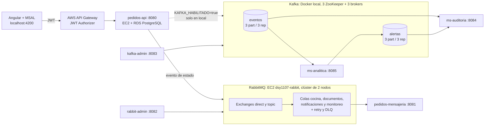

# Pedidos360 — DSY1107 Desarrollo Cloud Native I

Proyecto semestral: plataforma de gestión de pedidos con autenticación mediante
Microsoft Entra ID y autorización por roles.

**Autor:** Fabián Parrao Figueroa
**Asignatura:** DSY1107 — Desarrollo Cloud Native I (Duoc UC)
**Entregas:** proyecto acumulativo — EP1 (Pedidos y Catálogo), EP3–EP4 (RabbitMQ, sección 11), EP5–EP6 (Kafka, sección 12)

---

## 1. Descripción

Pedidos360 es una aplicación full stack que permite a una empresa gestionar su
catálogo de productos y el ciclo de vida de sus pedidos. El acceso se controla
con identidad federada: los usuarios se autentican contra Microsoft Entra ID
usando Authorization Code + PKCE, y cada operación se autoriza según el rol que
viaja dentro del token.

El proyecto es acumulativo: EP1 cubre dos módulos funcionales (Pedidos y
Catálogo), tres roles con diferencias reales de permisos y las pruebas de
seguridad 200/401/403; EP3 y EP4 agregan mensajería asíncrona con RabbitMQ
(sección 11); EP5 y EP6 agregan streaming de eventos con Kafka (sección 12).

---

## 2. Arquitectura

```
Angular 21 + MSAL
        │  Authorization Code + PKCE
        ▼
Microsoft Entra ID  ──► Access Token (JWT)
        │
        ▼
AWS API Gateway (HTTP API)
   · JWT Authorizer  → valida firma, issuer, audience y scope
   · CORS
        │
        ▼
Spring Boot 3.5 sobre EC2
   · Spring Security Resource Server
   · Autorización por rol y por scope
        │
        ▼
Amazon RDS PostgreSQL
```

La validación de seguridad ocurre en dos capas:

- **API Gateway** rechaza con **401** cualquier petición sin token o con token
  inválido. La petición no llega al backend.
- **Spring Security** rechaza con **403** los tokens válidos cuyo rol no
  autoriza esa operación.

### Mensajería y streaming (EP3 a EP6)



Diseño de mensajería: [`docs/EP3-EP4-mensajeria.md`](docs/EP3-EP4-mensajeria.md).
Arquitectura Kafka y tópicos: [`infra/kafka/README.md`](infra/kafka/README.md).

---

## 3. Tecnologías

| Capa              | Tecnología                                                    |
| ----------------- | ------------------------------------------------------------- |
| Frontend          | Angular 21, MSAL Angular 6, TypeScript                        |
| Backend           | Java 21, Spring Boot 3.5.16, Spring Security, Spring Data JPA |
| Identidad         | Microsoft Entra ID (OAuth 2.0 + OIDC)                         |
| Base de datos     | PostgreSQL 18 (Amazon RDS en la nube, Docker en local)        |
| Documentación API | springdoc-openapi (Swagger UI)                                |
| Mensajería        | RabbitMQ 4 (clúster de 2 nodos), Spring AMQP                 |
| Streaming         | Apache Kafka 3.9 (Confluent Platform 7.9.1), Spring Kafka, Kafka UI |
| Infraestructura   | AWS EC2, AWS API Gateway (HTTP API), Docker Compose           |

---

## 4. Estructura del proyecto

```
pedidos360/
├── backend-springboot/
│   ├── pedidos-api/
│   │   └── src/main/java/cl/duoc/dsy1107/pedidosapi/
│   │       ├── config/
│   │       │   ├── SecurityConfig.java     Reglas de autorización y JWT
│   │       │   └── DataInitializer.java    Carga inicial del catálogo
│   │       ├── controller/
│   │       │   ├── PedidoController.java   /api/orders
│   │       │   ├── CatalogController.java  /api/catalog/products
│   │       │   ├── AdminController.java    /api/admin/resumen
│   │       │   └── PublicoController.java  /api/publico
│   │       ├── dto/                        Objetos de entrada validados
│   │       ├── model/
│   │       │   ├── EstadoPedido.java       Enum con la máquina de estados
│   │       │   ├── Pedido.java
│   │       │   ├── ItemPedido.java
│   │       │   └── Producto.java
│   │       ├── repository/
│   │       └── service/
│   │           ├── PedidoService.java      Lógica de estados y stock
│   │           └── ProductoService.java
│   ├── pedidos-mensajeria/             Consumidores RabbitMQ por dominio (EP3–EP4)
│   ├── rabbit-admin/                   Administración de colas y exchanges (EP3–EP4)
│   ├── ms-auditoria/                   Consumidor Kafka: línea de tiempo de pedidos (EP5)
│   ├── ms-analitica/                   Consumidor y productor Kafka: alertas (EP5)
│   └── kafka-admin/                    Administración de tópicos y grupos Kafka (EP5)
│
├── frontend-angular/src/app/
│   ├── app.ts / app.html               Layout, navegación y sesión
│   ├── auth.service.ts                 Lectura de roles desde el token
│   ├── models.ts                       Tipos y transiciones válidas
│   ├── orders.service.ts
│   ├── catalog.service.ts
│   ├── dashboard/                      Resumen según rol
│   ├── orders/                         Gestión de pedidos
│   └── catalog/                        Gestión de catálogo
│
├── infra/
│   ├── cluster/                        Docker Compose: clúster RabbitMQ de 2 nodos
│   └── kafka/                          Docker Compose: clúster Kafka (3 ZooKeeper + 3 brokers)
│
├── docs/
│   └── EP3-EP4-mensajeria.md           Diseño y trazabilidad de mensajería RabbitMQ
│
└── local-dev/
    └── docker-compose.postgres.yml     PostgreSQL para desarrollo local
```

---

## 5. Configuración en Microsoft Entra ID

Se utilizan dos App Registrations, separando el cliente del recurso protegido.

**Pedidos360 (SPA — frontend)**

- Plataforma: Single-page application
- Redirect URI: `http://localhost:4200`
- Permiso delegado sobre la API: `Pedidos.Read`, `Pedidos.Write`
- Sin client secret: la SPA usa PKCE

**Pedidos360-API (backend)**

- Expone el scope `api://<CLIENT_ID_API>/Pedidos.Read`
- App Roles: `Admin`, `Operador`, `Cliente`
- `requestedAccessTokenVersion: 2` para emitir tokens v2

Los roles se asignan a cada usuario desde _Aplicaciones empresariales →
Usuarios y grupos_, y llegan al backend dentro del claim `roles` del access
token.

### Claims relevantes del token

| Claim   | Contenido                                            | Uso                                     |
| ------- | ---------------------------------------------------- | --------------------------------------- |
| `iss`   | `https://login.microsoftonline.com/<TENANT_ID>/v2.0` | Verifica el emisor                      |
| `aud`   | Client ID de Pedidos360-API                          | Verifica que el token sea para esta API |
| `scp`   | `Pedidos.Read`                                       | Permiso delegado                        |
| `roles` | `["Admin"]`, `["Operador"]` o `["Cliente"]`          | Autorización por rol                    |
| `sub`   | Identificador único del usuario                      | Identifica al dueño de cada pedido      |
| `exp`   | Fecha de expiración                                  | Vigencia del token                      |

---

## 6. Ejecución local

### Requisitos

Java 21, Node.js 22, Docker Desktop.

### 1. Base de datos

```bash
docker compose -f local-dev/docker-compose.postgres.yml up -d
```

### 2. Backend

```powershell
cd backend-springboot/pedidos-api

$env:DB_HOST="localhost"
$env:DB_PORT="5432"
$env:DB_NAME="pedidosdb"
$env:DB_USER="postgres"
$env:DB_PASSWORD="<contraseña>"

.\mvnw.cmd spring-boot:run
```

Disponible en `http://localhost:8080`.
Documentación de la API: `http://localhost:8080/swagger-ui.html`

### 3. Frontend

```bash
cd frontend-angular
npm install
npm start
```

Disponible en `http://localhost:4200`.

> Las credenciales de base de datos se inyectan por variables de entorno y no
> se versionan. El Tenant ID y los Client ID no son secretos y sí están en el
> código.

Para levantar el clúster RabbitMQ y los consumidores, ver la sección 11. Para el clúster Kafka, ver la sección 12.

---

## 7. Despliegue en AWS

| Componente    | Detalle                                                                             |
| ------------- | ----------------------------------------------------------------------------------- |
| Base de datos | Amazon RDS PostgreSQL — dsy1107-pedidos-db.crlbffxj6fqf.us-east-1.rds.amazonaws.com |
| Backend       | EC2 `dsy1107-pedidos` (Amazon Linux 2023, Java 21) — IP elástica 3.234.179.54      |
| API Gateway   | HTTP API — https://tjkn3r8p13.execute-api.us-east-1.amazonaws.com                   |
| Frontend      | Ejecución local en http://localhost:4200                                            |
| RabbitMQ y mensajería | EC2 `dsy1107-rabbit` — clúster de 2 nodos con Docker Compose, `pedidos-mensajeria` (8081) y `rabbit-admin` (8082) |

El JWT Authorizer del API Gateway se configura con:

- **Issuer:** `https://login.microsoftonline.com/84e517e6-6e52-43b3-82da-162220153ea3/v2.0`
- **Audience:** `d7a99a6a-b387-494e-a239-5ea101bb3856`
- **Scope requerido:** `Pedidos.Read`

El Security Group de RDS acepta conexiones en el puerto 5432 únicamente desde
el Security Group de la instancia EC2, de modo que la base de datos no queda
expuesta a Internet.

Kafka y Kafka UI no tienen fila en esta tabla: corren solo en local con Docker Compose (ver sección 12).

---

## 8. Endpoints y permisos

| Método | Ruta                         | Admin | Operador |     Cliente      |
| ------ | ---------------------------- | :---: | :------: | :--------------: |
| GET    | `/api/publico`               |   ✔   |    ✔     |  ✔ (sin token)   |
| GET    | `/api/orders`                | todos |  todos   | solo los propios |
| GET    | `/api/orders/{id}`           |   ✔   |    ✔     | solo los propios |
| POST   | `/api/orders`                |   ✔   |    ✔     |        ✔         |
| PUT    | `/api/orders/{id}/status`    |   ✔   |    ✔     |      ✘ 403       |
| GET    | `/api/catalog/products`      |   ✔   |    ✔     |        ✔         |
| GET    | `/api/catalog/products/{id}` |   ✔   |    ✔     |        ✔         |
| POST   | `/api/catalog/products`      |   ✔   |  ✘ 403   |      ✘ 403       |
| PUT    | `/api/catalog/products/{id}` |   ✔   |  ✘ 403   |      ✘ 403       |
| GET    | `/api/admin/resumen`         |   ✔   |  ✘ 403   |      ✘ 403       |

Los endpoints de administración de RabbitMQ se documentan en [`docs/EP3-EP4-mensajeria.md`](docs/EP3-EP4-mensajeria.md) (sección 4). Los de Kafka en [`infra/kafka/README.md`](infra/kafka/README.md) (sección "Administración").

---

## 9. Reglas de negocio

### Máquina de estados

```
CREADO ──► ACEPTADO ──► EN_PREPARACION ──► DESPACHADO ──► ENTREGADO
   │           │              │
   └───────────┴──────────────┴──► CANCELADO
```

Las transiciones válidas están declaradas en el enum `EstadoPedido`, no como
condicionales dispersos en el servicio. Cada estado conoce sus sucesores
posibles, y `cambiarEstado` consulta esa definición antes de aplicar cualquier
cambio.

**Un pedido no puede pasar a DESPACHADO sin haber pasado antes por ACEPTADO**,
porque desde `CREADO` los únicos destinos permitidos son `ACEPTADO` y
`CANCELADO`. Intentarlo devuelve **409 Conflict** indicando cuáles son las
transiciones posibles desde el estado actual.

Los estados `ENTREGADO` y `CANCELADO` son finales y no admiten cambios
posteriores.

### Descuento de stock

Al aceptar un pedido, el sistema descuenta del catálogo la cantidad de cada
ítem. La operación está anotada con `@Transactional`: si algún producto no
tiene stock suficiente, se lanza una excepción y se revierten todos los
descuentos junto con el cambio de estado. No queda stock descontado a medias
ni pedidos aceptados sin respaldo de inventario.

### Integridad de los datos

- **El precio lo asigna el servidor.** El cliente envía solo `productoId` y
  `cantidad`; el precio y el nombre se leen del catálogo al momento de crear el
  pedido. Esto impide que un cliente manipule el monto desde el navegador.
- **El precio queda congelado en el ítem.** Cada `ItemPedido` guarda una copia
  del precio unitario, de modo que un cambio posterior en el catálogo no altera
  los pedidos históricos.
- **El cliente se identifica por el token.** El campo `clienteId` se obtiene del
  claim `sub`, firmado por Entra ID. El frontend nunca envía el identificador
  del usuario, por lo que no es posible crear ni consultar pedidos a nombre de
  otra persona.

---

## 10. Pruebas de seguridad

| Escenario                                      | Resultado | Responsable                   |
| ---------------------------------------------- | --------- | ----------------------------- |
| Petición sin token a `/api/orders`             | **401**   | API Gateway / Spring Security |
| Token válido con rol correcto                  | **200**   | Spring Security               |
| Cliente intenta `POST /api/catalog/products`   | **403**   | Spring Security               |
| Cliente intenta cambiar el estado de un pedido | **403**   | Spring Security               |
| Operador intenta `CREADO → DESPACHADO`         | **409**   | Regla de negocio              |
| Cliente consulta el pedido de otro cliente     | **403**   | Regla de negocio              |

### Diferencias por rol en la interfaz

- **Admin:** gestiona el catálogo, cambia estados, ve el panel de productos con
  stock bajo.
- **Operador:** ve todos los pedidos y avanza sus estados; el catálogo es de
  solo lectura.
- **Cliente:** crea pedidos y consulta únicamente los suyos; no ve la columna
  con el nombre de otros clientes ni los controles de estado.

La interfaz solo ofrece las transiciones válidas para el estado actual del
pedido, pero esa restricción es una ayuda visual: la validación que realmente
protege el sistema ocurre en el backend.

### Pruebas unitarias

| Módulo          | Tests | Comando                                                   |
| --------------- | ----- | --------------------------------------------------------- |
| `rabbit-admin`  | 11    | `.\mvnw.cmd test` en `backend-springboot/rabbit-admin`    |

Los servicios Kafka (`ms-auditoria` 5, `ms-analitica` 5, `kafka-admin` 3) se detallan en la sección 12. Todos pasan sin infraestructura levantada.

---

## 11. Mensajería asíncrona (EP3 y EP4)

Pedidos360 incorpora RabbitMQ sobre lo anterior: `pedidos-api` publica un evento cuando un pedido cambia de
estado, `pedidos-mensajeria` lo consume por dominio (notificaciones, cocina, documentos) con reintentos y DLQ,
y `rabbit-admin` permite administrar colas, exchanges y bindings. El broker es un clúster de dos nodos con
Docker Compose (`infra/cluster`).

Diseño, política de errores, endpoints de administración y trazabilidad con la rúbrica:
[`docs/EP3-EP4-mensajeria.md`](docs/EP3-EP4-mensajeria.md).

---

## 12. Streaming con Kafka (EP5 y EP6)

Kafka complementa a RabbitMQ, no lo reemplaza. `pedidos-api` publica cada cambio de estado de un pedido en un tópico; `ms-auditoria` guarda la línea de tiempo de cada pedido; `ms-analitica` detecta anomalías (por ejemplo, una cancelación tardía) y publica alertas en un segundo tópico; y `kafka-admin` administra tópicos y grupos de consumo. El clúster es de 3 ZooKeeper + 3 brokers con Docker Compose (`infra/kafka`).

| Servicio             | Puerto | Función                                                                     |
| -------------------- | ------ | --------------------------------------------------------------------------- |
| `pedidos-api`        | 8080   | API principal. Productor Kafka si `KAFKA_HABILITADO=true`                   |
| `pedidos-mensajeria` | 8081   | Consumidores RabbitMQ                                                       |
| `rabbit-admin`       | 8082   | Administración de RabbitMQ (rol Admin)                                      |
| `kafka-admin`        | 8083   | Administración de Kafka (rol Admin). Variable `KAFKA_BOOTSTRAP_SERVERS`     |
| `ms-auditoria`       | 8084   | Consumidor (grupos `pedidos360-auditoria` y `pedidos360-auditoria-alertas`) |
| `ms-analitica`       | 8085   | Consumidor y productor (grupo `pedidos360-analitica`)                       |
| Kafka UI             | 8090   | Solo en `127.0.0.1`, sin login                                              |
| Front Angular        | 4200   |                                                                             |

### Variables de entorno

| Variable                  | Valor por defecto                                        | Servicios                               |
| ------------------------- | -------------------------------------------------------- | --------------------------------------- |
| `KAFKA_BOOTSTRAP_SERVERS` | `localhost:29092,localhost:39092,localhost:49092`         | Todos los servicios Kafka               |
| `KAFKA_HABILITADO`        | `false`                                                  | Solo `pedidos-api`; activa el productor |

Kafka no requiere credenciales: el clúster local usa `PLAINTEXT` sin autenticación.

### Levantar

```powershell
# 1. Clúster Kafka (desde la raíz del proyecto)
.\infra\kafka\scripts\01_iniciar_kafka.ps1
.\infra\kafka\scripts\02_verificar_cluster.ps1
.\infra\kafka\scripts\03_crear_topicos.ps1

# 2. ms-auditoria, ms-analitica, kafka-admin (cada uno en su terminal)
cd backend-springboot\<servicio>
.\mvnw.cmd spring-boot:run

# 3. pedidos-api: requiere PostgreSQL levantado y el productor activado
cd backend-springboot\pedidos-api
$env:KAFKA_HABILITADO = "true"
.\mvnw.cmd spring-boot:run
```

### Despliegue

Kafka corre solo en local con Docker Compose. En AWS (EC2) el productor de `pedidos-api` está desactivado (la variable `KAFKA_HABILITADO` no se define en la instancia) y RabbitMQ sigue siendo el mecanismo de mensajería activo.

### Pruebas

`.\mvnw.cmd test` dentro de `ms-auditoria` (5 pruebas), `ms-analitica` (5 pruebas) y `kafka-admin` (3 pruebas). Todos los tests pasan sin infraestructura levantada.

Arquitectura, tópicos, manejo de errores, scripts y trazabilidad con la rúbrica: [`infra/kafka/README.md`](infra/kafka/README.md).
