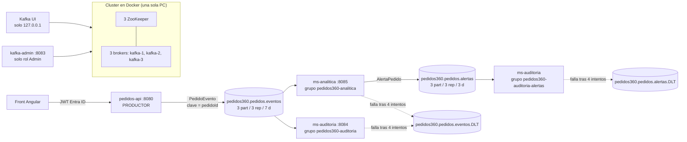

# Kafka en Pedidos360 (EP5 / EP6)

Kafka **complementa** a RabbitMQ, no lo reemplaza:

- **RabbitMQ** reparte trabajo: una cola, un consumidor lo procesa y el mensaje se descarta.
- **Kafka** guarda un registro ordenado de eventos de pedidos. Varios grupos de consumo lo leen de forma independiente, y se puede volver a leer.

## Arquitectura



| Componente  | Detalle                                                                                                         |
| ----------- | --------------------------------------------------------------------------------------------------------------- |
| Imágenes    | Confluent Platform 7.9.1 (Apache Kafka 3.9)                                                                     |
| ZooKeeper   | 3 nodos. Kafka 3.9 es la última línea que lo soporta (la 4.0 solo usa KRaft)                                    |
| Brokers     | 3. Escuchas `INTERNAL` (`kafka-N:19092`, entre contenedores) y `EXTERNAL` (`localhost:29092`, `39092`, `49092`) |
| Replicación | factor 3 y `min.insync.replicas=2`: con un broker caído se sigue escribiendo y leyendo                          |
| Tópicos     | creación automática **desactivada** (`AUTO_CREATE_TOPICS=false`); se crean con el script `03`                   |

## Tópicos y justificación

Todos con **3 particiones, 3 réplicas**, `min.insync.replicas=2` y `cleanup.policy=delete`: los mensajes se borran al vencer la retención (no se compactan, porque cada evento tiene valor por sí mismo).

| Tópico                           | Retención | Para qué                                                                                                                                                |
| -------------------------------- | --------- | ------------------------------------------------------------------------------------------------------------------------------------------------------- |
| `pedidos360.pedidos.eventos`     | 7 días    | Cada cambio de estado de un pedido. La clave es el `pedidoId`, así que **todos los eventos de un pedido caen en la misma partición y se leen en orden** |
| `pedidos360.pedidos.alertas`     | 3 días    | Alertas derivadas del análisis (por ejemplo, cancelación tardía). Son menos valiosas con el tiempo                                                      |
| `pedidos360.pedidos.eventos.DLT` | 14 días   | Mensajes de `eventos` que no se pudieron procesar. Se guardan más tiempo para investigar                                                                |
| `pedidos360.pedidos.alertas.DLT` | 14 días   | Lo mismo para `alertas`                                                                                                                                 |

Se usan **3 particiones** para que el grupo pueda tener 3 consumidores en paralelo (`concurrency=3`) y **3 réplicas** para sobrevivir a la caída de un broker.

## Productor (`pedidos-api`)

- Código en `backend-springboot/pedidos-api/.../mensajeria/` (`PedidoEventosKafkaPublisher`, `KafkaTopicos`).
- Publica **después del commit** de la base de datos (`@TransactionalEventListener(AFTER_COMMIT)`), para no emitir eventos de pedidos que luego se revierten.
- DTO `PedidoEvento(eventoId, pedidoId, clienteId, tipo, fecha)`, serializado a JSON sin cabeceras de tipo.
- `acks=all` + idempotencia: no se duplica un envío reintentado.
- Se activa solo con `pedidos360.kafka.habilitado=true` (variable `KAFKA_HABILITADO`). En la nube (EC2) está apagado porque ahí no hay Kafka.

## Consumidores

| Servicio       | Puerto | Grupo                          | Qué hace                                                                       |
| -------------- | ------ | ------------------------------ | ------------------------------------------------------------------------------ |
| `ms-auditoria` | 8084   | `pedidos360-auditoria`         | Guarda la línea de tiempo de cada pedido (`GET /api/auditoria/pedidos/{id}`)   |
| `ms-auditoria` | 8084   | `pedidos360-auditoria-alertas` | Guarda las alertas (`GET /api/auditoria/alertas`)                              |
| `ms-analitica` | 8085   | `pedidos360-analitica`         | Cuenta eventos por estado y **produce** alertas (`GET /api/analitica/resumen`) |

- La lógica de negocio está en una clase de servicio (`AuditoriaServicio`, `AnaliticaServicio`); el `@KafkaListener` solo recibe y delega.
- Procesamiento reactivo: cada evento llega al consumidor apenas se publica; `ms-analitica` reacciona generando una alerta, que a su vez es un nuevo evento.
- Cada grupo recibe **su propia copia** de todos los eventos.
- Configuración: `enable-auto-commit=false`, `ack-mode=record` (el offset se confirma solo si el mensaje se procesó) y `auto-offset-reset=earliest`.
- **Idempotencia:** se descartan eventos con un `eventoId` ya visto, porque un reintento no debe contarse dos veces.

## Manejo de errores

1. Si el procesamiento falla se **reintenta**: 1 segundo de espera y 3 reintentos, es decir **4 intentos en total**.
2. Si sigue fallando, el mensaje va al tópico `<tópico>.DLT`, **en la misma partición**, y el consumidor continúa con el siguiente.
3. Un mensaje que ni siquiera se puede deserializar, o un `IllegalArgumentException`, **no se reintenta**: va directo al DLT, porque repetirlo no lo arreglaría.

El DLT de Kafka es un tópico normal (se puede leer, medir y reprocesar). No es lo mismo que la DLQ de RabbitMQ.

## Administración

### Scripts (`infra/kafka/scripts`), en orden de uso

| Script                        | Qué hace                                                                    |
| ----------------------------- | --------------------------------------------------------------------------- |
| `01_iniciar_kafka.ps1`        | Levanta ZooKeeper, brokers y Kafka UI                                       |
| `02_verificar_cluster.ps1`    | Muestra los 3 ZooKeeper, los brokers registrados y el controlador           |
| `03_crear_topicos.ps1`        | Crea los 4 tópicos con su configuración                                     |
| `04_inspeccionar_topicos.ps1` | Líder, réplicas e ISR por partición, y offsets                              |
| `05_ver_consumer_groups.ps1`  | Grupos, estado, miembros y **lag** por partición                            |
| `06_modificar_retencion.ps1`  | Cambia `retention.ms` sin recrear el tópico (`-RetencionMs` para restaurar) |
| `07_simular_caida_broker.ps1` | Detiene un broker y muestra cómo el clúster sigue funcionando               |
| `08_recuperar_broker.ps1`     | Reinicia el broker, restablece los líderes preferidos y comprueba el ISR    |
| `09_detener_sin_borrar.ps1`   | Apaga todo sin perder datos (se vuelve a levantar con `01`)                 |

### Microservicio `kafka-admin` (puerto 8083)

Seguridad: JWT de Entra ID, solo rol `Admin`. Swagger en `/swagger-ui.html`.

| Método | Ruta                          | Acción                                                           |
| ------ | ----------------------------- | ---------------------------------------------------------------- |
| GET    | `/api/kafka/topicos`          | Lista tópicos                                                    |
| GET    | `/api/kafka/topicos/{nombre}` | Configuración y líder/réplicas/ISR por partición                 |
| POST   | `/api/kafka/topicos`          | Crea un tópico (1–12 particiones, 1–3 réplicas)                  |
| PATCH  | `/api/kafka/topicos/{nombre}` | Cambia retención, política de limpieza o **aumenta** particiones |
| DELETE | `/api/kafka/topicos/{nombre}` | Elimina un tópico (los `pedidos360.*` están protegidos: 409)     |
| GET    | `/api/kafka/grupos`           | Lista grupos de consumo                                          |
| GET    | `/api/kafka/grupos/{grupoId}` | Offsets, fin de log y **lag** por partición                      |

Reglas: Kafka no permite reducir particiones (400), y los tópicos del sistema no se eliminan.

## Cómo levantar todo

```powershell
# 1. Cluster Kafka (desde la raíz del repo)
.\infra\kafka\scripts\01_iniciar_kafka.ps1
.\infra\kafka\scripts\02_verificar_cluster.ps1
.\infra\kafka\scripts\03_crear_topicos.ps1

# 2. Microservicios (cada uno en su terminal, dentro de backend-springboot\<servicio>)
.\mvnw.cmd spring-boot:run
```

Servicios: `ms-auditoria`, `ms-analitica`, `kafka-admin` y `pedidos-api`. Para este último hay que activar el productor con la variable `KAFKA_HABILITADO=true` y tener PostgreSQL levantado. Después se crea o cambia el estado de un pedido desde el front y se consulta el resultado en los endpoints de arriba, en Kafka UI o con el script `05`.

## Dónde está cada indicador de la rúbrica (EP5)

| Indicador                                   | Dónde                                                                                                                                    |
| ------------------------------------------- | ---------------------------------------------------------------------------------------------------------------------------------------- |
| Productores (DTO y serializadores)          | `pedidos-api/.../mensajeria/PedidoEventosKafkaPublisher.java`, `ms-analitica/.../AlertasPublisher.java` y los `modelo/` de cada servicio |
| Consumidores (lógica separada)              | `PedidoEventosConsumidor` y `AlertasConsumidor` (solo escuchan) más `AuditoriaServicio` y `AnaliticaServicio` (negocio)                  |
| Configuración del cliente                   | `application.properties` de cada servicio y `KafkaAdminConfig` en `kafka-admin`                                                          |
| Dos tópicos                                 | `eventos` y `alertas` (más sus DLT), creados con el script `03`                                                                          |
| Errores y reintentos                        | `config/KafkaErroresConfig.java` en `ms-auditoria` y `ms-analitica`                                                                      |
| Retención, limpieza, particiones, réplicas  | `docker-compose.kafka.yml`, scripts `03` y `06`, y `PATCH` en `kafka-admin`                                                              |
| Grupos de consumo                           | 3 grupos; script `05` y `GET /api/kafka/grupos`                                                                                          |
| Microservicio de administración             | `backend-springboot/kafka-admin`                                                                                                         |
| Scripts y APIs de administración replicable | `infra/kafka/scripts/01` al `09` y los endpoints de `kafka-admin`                                                                        |

## Límites conocidos

- **Un solo equipo:** los 3 brokers corren en la misma PC. Se demuestra la tolerancia a la caída de un broker, pero no a la de la máquina.
- **Sin patrón outbox:** si la API se cae justo después del commit y antes de publicar, ese evento se pierde. Una solución sería guardar el evento en la misma transacción y publicarlo después.
- **Estado en memoria:** `ms-auditoria` y `ms-analitica` pierden su estado al reiniciarse y continúan desde el último offset confirmado. Se reconstruye con `kafka-consumer-groups --reset-offsets --to-earliest` (con la app detenida) o persistiendo en una base de datos.
- **Aumentar particiones** cambia a qué partición va cada clave nueva, así que se pierde el orden entre eventos antiguos y nuevos de un mismo pedido.
- **Sin cifrado ni autenticación en el clúster** (PLAINTEXT, solo local). Kafka UI no tiene login y está enlazado únicamente a `127.0.0.1`.
- **Kafka solo corre en local:** en AWS (EC2) el productor está desactivado.

## Kafka (EP5 / EP6)

Arquitectura, tópicos, consumidores, manejo de errores y administración: ver [`infra/kafka/README.md`](infra/kafka/README.md).
